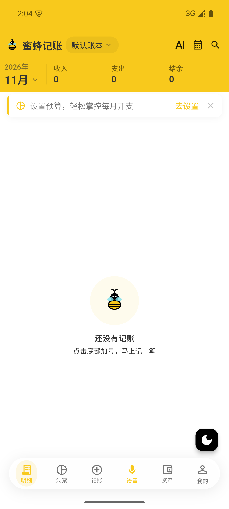
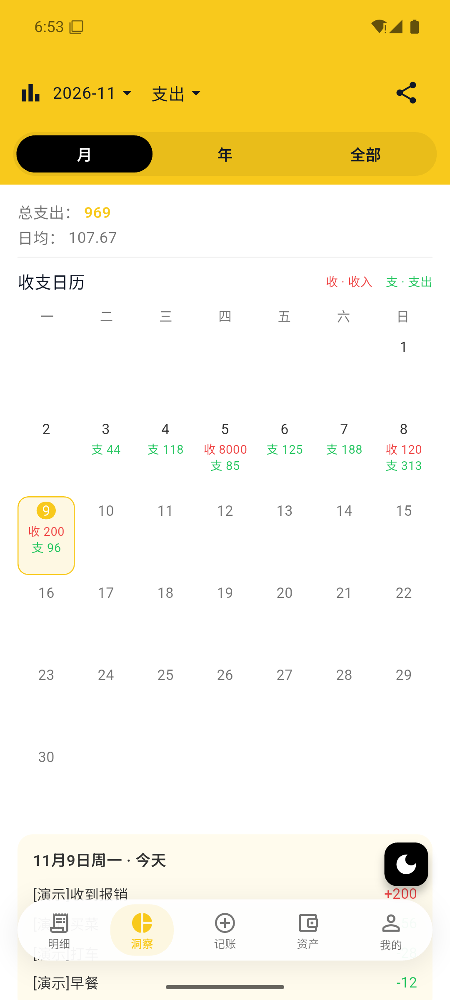
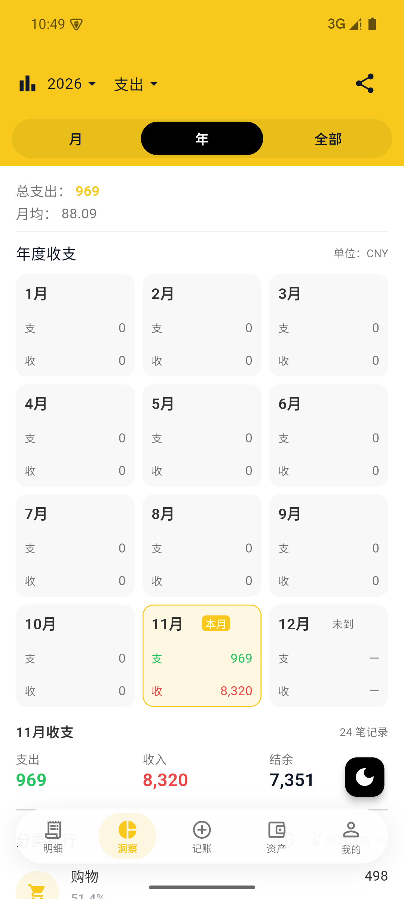
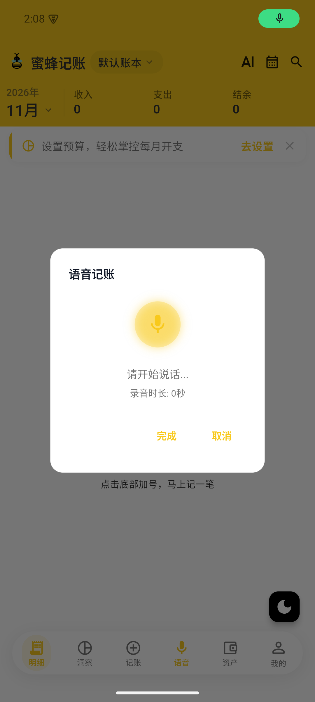

# 🐝 蜜封记账自用版

**Set up once · Speak naturally · Log multiple entries**

🗓️ Income & expense calendars　·　🎙️ Voice entry　·　📊 Category statistics

## 💛 About This Edition

A personal-use modification of **BeeCount**, with improvements to **income and expense displays and voice input**. Clearer calendars and an accessible voice shortcut make everyday bookkeeping easier, reduce repetitive entry, and help build a regular habit.

Breakfast, a taxi ride, groceries, or a reimbursement — say what happened and keep track as you go. ✨

## 📱 Screenshots

| 🎙️ Home · Voice shortcut | 🗓️ Month · Daily income and expenses |
|:---:|:---:|
|  |  |
| Voice entry beside the Add button | Select a date to see its entries |

| 📊 Year · Twelve months at a glance | 🎤 Voice · Speak multiple entries |
|:---:|:---:|
|  |  |
| Monthly totals and a selected-month summary | Record several expenses or income items at once |

Screenshots are from different development stages. Calendar amounts are demo data that has since been cleared; the home screenshot shows the empty ledger afterward. The displayed UI is in Chinese.

### 🔗 Original project: **[TNT-Likely/BeeCount](https://github.com/TNT-Likely/BeeCount)**

## ✨ What Changed

| Improvement | Everyday benefit |
|---|---|
| 🗓️ **Monthly calendar** | Replaces the monthly line chart with income and expenses shown under each date. |
| 📊 **Yearly cards** | Replaces the yearly line chart with twelve monthly income and expense cards. |
| 🎙️ **Home voice shortcut** | Places Voice beside Add in the bottom navigation for quick access. |
| 🗣️ **Speech recognition fixes** | Adjusts the recording format and improves failure messages. |
| 🤖 **AI provider configuration** | Adds a DeepSeek preset alongside Zhipu speech recognition, using your own keys. |

## 🧾 Main Features

The edition also retains the original project's everyday bookkeeping features:

- **✍️ Manual entries** — record income and expenses with categories, amounts, and notes.
- **🎙️ Multiple entries by voice** — split spoken transactions and save them individually.
- **📈 Statistics** — review calendars and category rankings to understand spending.
- **📚 Multiple ledgers and accounts** — organize different uses and transfer between accounts.
- **🏷️ Budgets, tags, and recurring transactions** — organize records and regular expenses.
- **📥 Import and export** — bring in existing transactions or export a backup.

## 🚀 How to Use

**Configure your AI service keys to start using voice entry.** Manual entries do not require AI configuration.

1. **🔑 Set up your keys** in provider management, as described below.
2. **🎙️ Tap Voice** beside Add on the home screen, and allow microphone access when prompted.
3. **🗣️ Speak your entries**, then tap Done. The app extracts the transactions and saves them automatically.
4. **✅ Review the results** in the transaction list, make corrections there, and explore monthly or yearly totals in Insights.

### 💬 One Recording, Multiple Entries

For example, say in Chinese:

> “早餐12元、打车28元、买菜56元、收到报销200元。”

This can be split into:

| Item | Type | Amount |
|---|:---:|---:|
| 🍳 Breakfast | Expense | ¥12.00 |
| 🚕 Taxi | Expense | ¥28.00 |
| 🥬 Groceries | Expense | ¥56.00 |
| 💰 Reimbursement received | Income | ¥200.00 |

**Say it once instead of filling in each transaction separately.** Everyday Chinese amount expressions are also supported, such as “花了12块七毛五”.

> 💡 Each recording is limited to **29 seconds**. Successfully recognized entries are saved directly. Review them afterward; if some entries fail, check what was saved before adding the missing items.

## 🔑 AI Configuration

In the Chinese UI, open **我的 → 智能记账 → AI小助手 → 服务商管理** and enter your own provider keys.

| Default service | Role | Current preset |
|---|---|---|
| **DeepSeek** | Interpret text and extract transactions | `deepseek-flash` |
| **Zhipu GLM** | Transcribe recorded speech | `glm-asr-2512` |

The default voice workflow requires **both DeepSeek and Zhipu keys**. Provider addresses and model names are preset; enter valid keys and confirm the corresponding capability bindings.

🔐 **This edition's source and new APKs contain no embedded API keys.** Enter your own keys inside the app.

## 📂 Where Data Is Stored

- **On the device running the app** — a phone keeps the ledger in its private app storage; an emulator keeps it inside the emulator.
- **AI recognition requires a connection** — audio and text are sent to the configured services. Local ledger storage does not make AI recognition offline.
- **Export for backup** — keep exported transaction copies for retention and migration.
